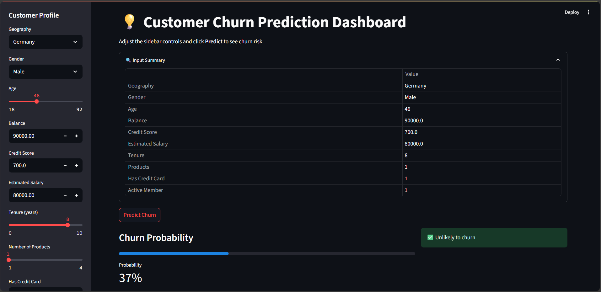

# 🌀 Customer Churn Prediction Dashboard

This project is an interactive **Streamlit app** to predict customer churn in a banking dataset.
It combines a trained deep learning model, preprocessing pipeline, and user-friendly UI to estimate churn probability and help understand customer risk.

---

## Demo

👉 **[Open the app](https://customer-churn-prediction-deep-learning-ntualewqmhmfy4sijvyzuq.streamlit.app/)**



---

## Features

- Predict churn for individual customers by adjusting sidebar inputs.
- Display churn probability and a likely/unlikely classification.
- Encode categorical inputs and scale numeric features.
- Load a trained Keras model and saved preprocessing artifacts.
- Run as an interactive Streamlit application.

---

## Project structure

```
.
├── app.py
├── prediction_utils.py
├── tests/
│   └── test_prediction_utils.py
├── prediction.ipynb
├── experiments.ipynb
├── model.h5
├── label_encoder_gender.pkl
├── onehot_encoder_geo.pkl
├── scaler.pkl
└── requirements.txt
```

---

## How it works

1. The user selects customer attributes in the sidebar.
2. Categorical fields are encoded and numeric features are scaled using the saved preprocessing objects.
3. The trained Keras model produces one churn score.
4. The application validates that the model returned exactly one finite probability in the inclusive range [0, 1].
5. The dashboard displays the rounded probability and a threshold-based likely/unlikely label.

Unexpected prediction errors are logged server-side. The public UI displays a generic message instead of reflecting exception details or submitted feature values.

---

## Run locally

Use a Python environment compatible with the TensorFlow version used to create the committed model artifact.

```bash
python -m pip install -r requirements.txt
streamlit run app.py
```

The application expects the model and preprocessing artifacts listed in the project structure to be present at the repository root.

---

## Tests and CI

Run the dependency-free prediction-contract tests:

```bash
python -m unittest discover -s tests -v
```

GitHub Actions also compiles the Python sources and runs these tests on Python 3.11. The tests validate output shape and probability handling without loading the TensorFlow model or claiming to measure model accuracy, calibration, or performance.

---

## Tech stack

- Python
- Streamlit
- TensorFlow / Keras
- scikit-learn
- pandas / NumPy

---

## Scope and limitations

- This is an educational demonstration, not a production credit-risk or customer-retention decision system.
- The regression tests validate the model-output contract; they do not retrain the model or establish predictive quality.
- The model and preprocessing artifacts are loaded from local files. Only load trusted pickle artifacts because unpickling untrusted files can execute code.
- The displayed probability is the model's output and has not been independently calibrated by this repository.

---

## Acknowledgements

Built for learning and demonstration, using the open-source Python, TensorFlow, scikit-learn and Streamlit ecosystems.
